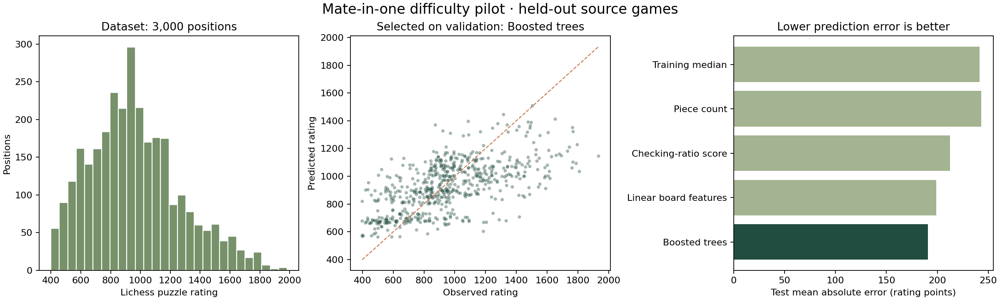

# Mate-in-one difficulty pilot v1

Question: can board-derived features predict Lichess ratings among mate-in-one puzzles?

The validation-selected model was Boosted trees. Its held-out MAE was 190.7 rating points, compared with 241.3 for the training-median baseline (21.0% lower error).

This is a measured result for this sample and split, not evidence that a model understands human reasoning or improves learning.

## Data and evaluation

3,000 validated unique positions, 24 board-derived features. Splits: {'train': 1800, 'validation': 600, 'test': 600}. Source-game grouped 60/20/20 split after exact/mirrored deduplication; train fits parameters and scaling, validation selects settings/model, test reports results once.

Raw mathematical score: D = log(checking moves / mating moves). Its test Spearman correlation was 0.522. The rating-scale score below fits a linear mapping on training data; the raw score is not itself an Elo rating.

| Model | Validation MAE | Test MAE | Test Spearman |
| --- | ---: | ---: | ---: |
| Training median | 239.8 | 241.3 | undefined (constant predictions) |
| Piece count | 236.7 | 242.9 | 0.080 |
| Checking-ratio score | 213.1 | 212.5 | 0.522 |
| Linear board features | 200.4 | 198.9 | 0.600 |
| Boosted trees | 191.5 | 190.7 | 0.619 |

Selected-model minus median-baseline MAE difference, 95% game-bootstrap interval: [-63.13662360329954, -38.968387322461936]. 1000 source-game bootstrap resamples; negative MAE differences favor the selected model. This excludes training and model-selection uncertainty.

## Independent chess checks

python-chess and chess.js agreed on legal, checking, and mating move sets and the reply counts after every check for 3,000 positions. This verifies the checked board calculations, not the rating model or arbitrary lesson prose.

## Limits

- A seeded sample of a quality-filtered bounded prefix, not a representative sample of every puzzle or learner.
- Ratings are noisy, platform-specific aggregate outcomes. The CSV does not provide individual solve times or player attempts.
- Exact/mirrored duplicates are removed and source games are grouped; other near-duplicate tactical patterns may remain.
- The holdout becomes a development set if repeatedly inspected and used to redesign the model; use new held-out data for future confirmatory claims.
- Model associations are not causal explanations of human difficulty. Generalization to composed teaching puzzles is untested.
- No human learning improvement or player rating prediction is established by this study.

Source: [Lichess CC0 puzzle database](https://database.lichess.org/#puzzles). See results.json for sample provenance, hashes, versions, settings, and counts. Predictions and split assignments are saved separately.
